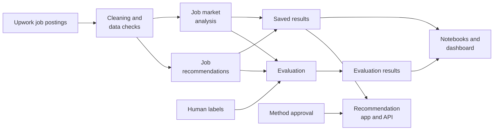

# Job Market Analysis and Recommendation System

[](https://github.com/manishanagda1997-debug/job-market-analysis/actions/workflows/ci.yml)

This project analyses 244,828 Upwork job postings to understand job demand, hourly pay, market trends and client countries. It covers all eight tasks in the assignment and includes a job recommendation system, a market dashboard, a JSON API, SQL checks and a Docker deployment.

The analysis uses one pipeline to prepare the data and save the results. Human labels help evaluate job categories, work-arrangement wording and recommendations. The notebooks show the analysis, while the [final report](reports/final_report.md) ([PDF](reports/final_report.pdf)) explains the findings in detail. Its Section 14 sets out what the results mean for job seekers, clients and market analysts.

## Main results

Each number in this table is recalculated from the committed output tables by `tests/test_readme.py`.

<!-- key-results:start -->
| Task | Result | Evidence |
|---|---|---|
| 1. Title words and pay | After adjusting for client country and job category, titles with "consultant" offer about +77% higher hourly rates and "virtual assistant" about -38% | [Notebook 04](notebooks/04_pay_keywords_and_countries.ipynb) |
| 2. Emerging categories | 9 of 22 job functions change share significantly over 37 days; Digital Marketing gains +1.0 percentage points (+10%) and Writing & Content falls from 5.8% to 3.7% of postings (-35%) | [Notebook 05](notebooks/05_trends_and_online_hiring.ipynb) |
| 3. High-demand roles | Web Development has the highest expected demand, about 900 jobs a day; the weekday-mean model performs better than the seasonal baseline for 20 of 23 category series in the final week (mean relative MAE 0.84). The baseline performs better for total jobs | [Notebook 06](notebooks/06_forecasts.ipynb) |
| 4. Hourly rates by country | 91 client countries have at least 30 rated hourly jobs; the United States median offer is USD 25 per hour (mean USD 32.6) | [Notebook 04](notebooks/04_pay_keywords_and_countries.ipynb) |
| 5. Job recommendations | Hybrid TF-IDF reaches mean nDCG@5 0.985 and strict Precision@5 0.967 over 12 blind-labelled profiles, with one more relevant result than word TF-IDF in 60 evaluated slots | [Notebook 07](notebooks/07_job_recommendations.ipynb) |
| 6. Monthly dashboard | The dashboard draws monthly and weekly tables that a rebuild refreshes with each new extract; the current build covers 2 partial months (14 days of February and 23 days of March 2024) | [Monthly table](data/processed/monthly_market_summary.csv) |
| 7. Online hiring | The hourly-job share falls from 58.3% to 56.1%; North American clients post about 46% of jobs with a known country; 1,260 of 229,520 postings (0.55%) have remote or home wording in the title | [Notebook 05](notebooks/05_trends_and_online_hiring.ipynb) |
| 8. Future trends | 4 categories meet the rule for a small rise under the damped-trend model and 10 have no reliable direction; the 80% forecast ranges contain 75.0% of final-week demand values | [Notebook 06](notebooks/06_forecasts.ipynb) |
<!-- key-results:end -->

## Screenshots


## How the system works



Human labels help write and evaluate the category and work-arrangement rules, and evaluate the job recommendations. Recommendation rankings use job titles, not the human labels. The app serves only a recommendation method with recorded approval.

## How to run

### 1. Get the data

The source file is the Upwork CSV supplied with the assignment. It is not stored in this repository.

| Item | Value |
|---|---|
| File name | `all_upwork_jobs_2024-02-07-2024-03-24.csv` |
| Location | `data/raw/` |
| Rows | 244,828 (plus a header row) |
| SHA-256 | `6513e9a744f15726bdb40d6435a60834e864ace08a75e1d7feb75e10ddb78b11` |

Download it from the dataset link in the assignment brief: https://drive.google.com/file/d/1cytIiowYuhUlvBTuC8npw9qGjMCaTQu_/view?usp=sharing. Place it in `data/raw/` without opening or re-saving it, because a spreadsheet program can change the file. On Windows, compare the file with the table above:

```bash
certutil -hashfile data\raw\all_upwork_jobs_2024-02-07-2024-03-24.csv SHA256
```

### 2. Create the environment

From a terminal (Anaconda Prompt on Windows) in the project folder:

```bash
conda env create -f environment.yml
conda activate jobmarket
pip install -e . --no-deps
```

`environment.yml` pins Python 3.11 and every package that can change a result. `pip install -e .[dev]` also works in any Python 3.10+ environment; the commands then print a warning for each version that differs from the pins.

### 3. Rebuild and verify

```bash
python -m job_market rebuild        # every generated file from the raw CSV (about 5 minutes)
python -m job_market run-notebooks  # runs the ten notebooks in fresh kernels
python -m job_market check          # every output and notebook matches this build
```

Without the data, the notebooks can still be read on GitHub with their saved outputs, `00` to `09` in order.

### 4. Web app and API

```bash
python -m job_market serve          # then open http://localhost:5000
```

The recommendation page is at `/` and the dashboard at `/dashboard`. The API returns JSON, for example:

```text
http://localhost:5000/api/recommend?skills=python%2C%20sql&contract=hourly&min_hourly=30
```

[`docs/api.md`](docs/api.md) documents every endpoint, parameter, response field and error.

### 5. Monthly refresh (Task 6)

The source has no live feed, so the dashboard refreshes when a new extract is added:

1. Put the new CSV in `data/raw/` and point `raw_csv` in `config/pipeline.toml` to it.
2. Run `rebuild`, `run-notebooks` and `check`.
3. Restart the app. New months and weeks appear automatically, and partial months are labelled.

### 6. Docker

With Docker Desktop running and a finished build in `data/processed`:

```bash
docker compose up -d --build        # then open http://localhost:8080
```

Nginx (web server) passes requests to Gunicorn and Flask (application server), which reads `data/processed` read-only. The first image build takes about 15 minutes.

| Task | Command |
|---|---|
| Status (the app should become `healthy`) | `docker compose ps` |
| Application logs | `docker compose logs -f app` |
| Stop | `docker compose down` |
| Rebuild the outputs inside Docker | `docker compose --profile pipeline run --rm pipeline` |

## Project structure

| Folder or file | Contents |
|---|---|
| `src/job_market/` | Pipeline, analysis steps and quality checks |
| `src/job_market_web/` | Flask app: recommendation page, API and dashboard |
| `notebooks/` | Analysis notebooks `00` to `09`, with saved outputs |
| `data/processed/` | Output tables and the run manifest (the large `.parquet` and SQLite files are rebuilt, not committed) |
| `data/labels/` | Human label sheets and the records that tie them to the source data |
| `sql/` | SQLite schema and the eight cross-check queries |
| `config/` | All settings (`pipeline.toml`) and the recommender approval record |
| `reports/` | Final report, its figures and the work-arrangement audit |
| `docs/` | Decision log, labelling guides, API reference and screenshots |
| `docker/`, `docker-compose.yml` | App and Nginx images |
| `tests/` | Automated tests |

The project uses Python, Pandas, SQL (SQLite), scikit-learn, Matplotlib, Plotly, Flask and Docker.

## Evaluation and limitations

<!-- evaluation:start -->
- **Data:** 244,828 postings are cleaned; 229,520 jobs fall in the reliable 37-day window (16 Feb to 23 Mar 2024).
- **Job categories:** 68.9% agreement with blind human labels (241 of 350 titles; 95% interval 63.8% to 73.5%).
- **SQL cross-checks:** 8 SQL queries and 2 extra SQL checks match all 1,358 compared pipeline values.
<!-- evaluation:end -->

- **Titles only.** The data has no job descriptions, so categories, pay words and recommendations work from short titles.
- **A short window.** 37 reliable days give five-week changes and 14-day forecasts, not long-term trends.
- **Imperfect categories.** Every category-based result carries the uncertainty of the categorisation.
- **Missing pay.** About 27% of hourly jobs state no rate; hourly results use jobs with a complete rate range.
- **Associations, not causes.** A title word that goes with higher pay does not make a job pay more.
- **Forecast ranges.** The ranges reflect past forecast errors only and contain fewer final-week values than the intended 80%.
- **One labeller.** I assign all human labels myself, so they reflect one person's judgement.

The [final report](reports/final_report.md) and the notebooks give the full results and their limits.

## Reproducibility

Each build records SHA-256 fingerprints of the raw data, settings, code, pinned environment, SQL files and recorded label inputs, and a hash of every output file. `check` confirms that all of them match the current build, that the recommender approval fits the implementation and that every notebook is a clean run of this build.

The official build is `20261011T132714Z-e537465460`. Two rebuilds from the same inputs produce byte-identical outputs for all 54 analytical output files; only the run manifest differs, because it records the run ID and times. Its ten notebooks run in strict mode (`JOB_MARKET_STRICT=1`) on the pinned environment, and the lineage check passes with 0 errors and 0 warnings. Continuous integration runs the tests, checks the committed notebooks and builds the Docker images on every push.

| Command | What it confirms |
|---|---|
| `rebuild` | Produces every output from the source data, settings and label files in one recorded run |
| `run-notebooks` | Every notebook runs top to bottom in a fresh kernel |
| `check` | Inputs, outputs, approval and notebooks all match the build |
| `check-notebooks` | The notebook part of `check`, without the raw CSV (used by CI) |
| `verify` | `rebuild`, `run-notebooks` and `check` in one command |

Each analytical decision, with its reason and evidence, is in [`docs/decisions.md`](docs/decisions.md).
