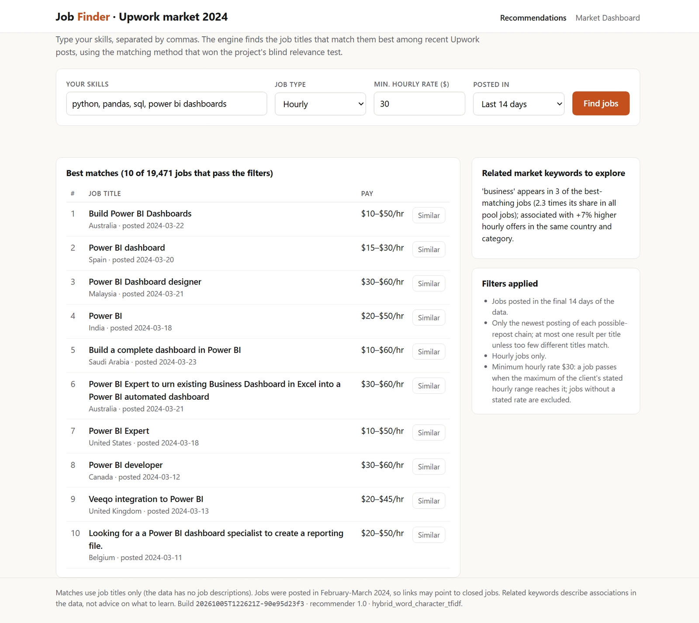
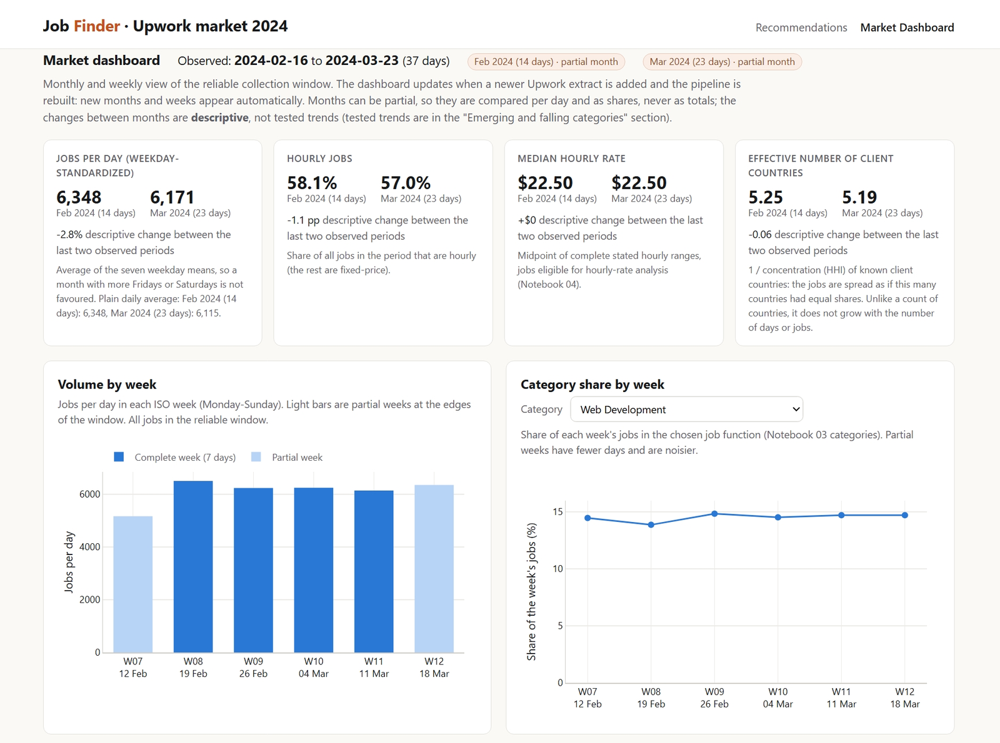

# Job Market Analysis and Recommendation System

[](https://github.com/manishanagda1997-debug/job-market-analysis/actions/workflows/ci.yml)

Analysis of 244,828 Upwork job postings (mostly February and March 2024) that
answers all eight tasks of the assignment brief: which title words go with
higher pay, which job categories are emerging, which roles will be in demand,
how hourly rates differ by client country, how the online-hiring landscape is
changing, and what the next weeks are likely to bring. It also delivers a job
recommendation engine with a JSON API and web page, a market dashboard, an
SQL cross-check layer and a Docker deployment (Nginx + Gunicorn + Flask).

One reproducible pipeline produces every result from the raw CSV; the
notebooks only read its verified outputs, and every number quoted in a
notebook is checked by code in the same notebook. Continuous integration runs
the tests, checks the committed notebooks and builds the Docker images on
every push.

**Final report:** [`reports/final_report.md`](reports/final_report.md) (also as [PDF](reports/final_report.pdf)) brings the results of all eight tasks together in one document.



## Quick start for reviewers

**Route A - no setup (recommended first).** Read the notebooks on GitHub in
order, `00` to `08` (see [Notebooks](#notebooks)). They are committed with their executed
outputs, from one build, and CI checks that they are clean top-to-bottom runs
of that build. The summary tables behind them are committed in
`data/processed/*.csv` and can be opened directly. This route needs no
download, but it cannot start the web app: the large generated files (the
`.parquet` tables and the SQLite database) are not in the repository and are
rebuilt from the raw CSV in Route B.

**Route B - full local rebuild.** Get the source CSV ([Data setup](#data-setup)),
create the pinned environment ([Setup](#setup)), then run:

```bash
python -m job_market rebuild        # about 5 minutes on the author's laptop
python -m job_market run-notebooks  # re-executes the nine notebooks
python -m job_market check          # PASS = every output matches this build
python -m job_market serve          # web app at http://localhost:5000
```

**Route C - Docker.** After Route B's `rebuild` (or the Docker pipeline
command), with Docker Desktop running:

```bash
docker compose up -d --build        # then open http://localhost:8080
```

The first image build takes about 15 minutes; later starts take under a minute.

See [Docker](#docker) for status, logs, stopping and deployment.

## Tasks 1-8 at a glance

| Task | What the brief asks | Where answered | Main evidence |
|---|---|---|---|
| 1 | Correlation between title keywords and offered salaries | Notebook 04 (Task 1); dashboard: title words and hourly offers | `pay_keywords_hourly.csv`, `pay_keywords_budget.csv`, `pay_prediction.csv` |
| 2 | Emerging job categories from posting frequency | Notebook 03 (categories), Notebook 05 (Task 2); dashboard: emerging and falling categories | `trend_categories.csv`, `trend_keywords.csv`, `label_evaluation_summary.csv` |
| 3 | Predict high-demand roles: model, accuracy metrics, demand trend visual | Notebook 06; dashboard: forecast and category outlook | `forecast_model_choice.csv`, `forecast_final_evaluation.csv`, `forecast_demand_outlook.csv` |
| 4 | Hourly rates by country: interactive map or chart | Notebook 04 (Task 4, interactive map); dashboard: country map | `pay_countries.csv`, `pay_country_sensitivity.csv` |
| 5 | Recommendation engine: working prototype, API documentation, user interface | Notebook 07; web app `/` and the [API](#web-app-task-5) | `recommend_relevance_summary.csv`, `recommend_checks.csv` |
| 6 | Dashboard that updates monthly with new trends | Web app `/dashboard`; [monthly refresh](#market-dashboard-task-6) | `monthly_market_summary.csv`, `monthly_category_share.csv`, `weekly_market_summary.csv` |
| 7 | Remote-work trends, with data-backed forecasts | Notebook 05 (Task 7), Notebook 06 (signal forecasts); dashboard: online hiring signals | `remote_series_trends.csv`, `remote_signals_weekly.csv`, `forecast_signals_outlook.csv` |
| 8 | Predict future job-market trends, with possible scenarios | Notebook 06 (category direction and empirical ranges) | `forecast_demand_outlook.csv`, `forecast_backtest_14d.csv` |

All evidence files are in `data/processed/`. SQL (Notebook 08) independently
reproduces selected results of Tasks 4, 5 and 6 and the category evaluation.

## Key results

Each number below is checked against the committed output tables by
`tests/test_readme.py`.

<!-- key-results:start -->
| Area | Result | Evidence |
|---|---|---|
| Data | 244,828 postings cleaned; 229,520 jobs in the reliable 37-day window (16 Feb - 23 Mar 2024) | [Notebook 01](notebooks/01_data_audit_and_cleaning.ipynb) |
| Task 1: pay words | Among similar jobs (same client country and category), titles with "consultant" offer about +77% higher hourly rates and "virtual assistant" about -38% | [Notebook 04](notebooks/04_pay_keywords_and_countries.ipynb) |
| Task 2: emerging categories | 9 job functions change share significantly; Writing & Content falls from 5.8% to 3.7% of postings (-35%) and Digital Marketing gains +1.0 percentage points (+10%) | [Notebook 05](notebooks/05_trends_and_online_hiring.ipynb) |
| Tasks 3 and 8: forecasts | The weekday-mean model, chosen in advance by backtest, beats the seasonal-naive baseline for 20 of 23 category series in the reserved final week (mean relative MAE 0.84); for total volume the baseline is better | [Notebook 06](notebooks/06_forecasts.ipynb) |
| Task 4: countries | 91 client countries have at least 30 rated hourly jobs; the United States median offer is $25/h | [Notebook 04](notebooks/04_pay_keywords_and_countries.ipynb) |
| Job categories | 68.9% agreement with blind human labels (241 of 350 titles; 95% interval 63.8%-73.5%) | [Notebook 03](notebooks/03_job_categories.ipynb) |
| Task 5: recommender | Hybrid TF-IDF: mean nDCG@5 0.985 and strict Precision@5 0.967 over 12 blind-labelled profiles (keyword baseline nDCG@5 0.953) | [Notebook 07](notebooks/07_job_recommendations.ipynb) |
| SQL cross-checks | 8 SQL queries reproduce every compared pipeline value (counts exactly, decimals within the 6-decimal rounding of the stored tables) | [Notebook 08](notebooks/08_sql_cross_checks.ipynb) |
<!-- key-results:end -->



## Limitations

- **Titles only.** The data has no job descriptions or skills lists, so
  categories, pay words and recommendations all work from short titles.
- **A short window.** 37 reliable days (16 February - 23 March 2024). Trends
  are changes within five weeks, and forecasts are short-range (14 days).
- **Missing pay is not random.** Many jobs state no rate or budget, and those
  jobs differ from the rest, so pay results describe jobs that state pay.
- **Categories are imperfect.** 68.9% agreement with blind human labels;
  every category-based result inherits that uncertainty.
- **Associations, not causes.** A title word that goes with higher pay does
  not make a job pay more.
- **Old postings, no live feed.** The jobs are from 2024 and most links now
  point to closed jobs; the dashboard refreshes when a new extract is added,
  not automatically.

## Tools used

| Tool | Where it is used |
|---|---|
| Python, Pandas | The whole pipeline (`src/job_market/`) and the notebooks |
| SQL (SQLite) | `sql/`: schema and eight queries that recompute results from row-level data (Notebook 08) |
| scikit-learn | TF-IDF features, the category classifier (logistic regression), the pay model (ridge regression) and the recommender's TF-IDF matching |
| Matplotlib | Static charts in the notebooks |
| Plotly | Interactive country map (Notebook 04) and every dashboard chart, served offline |
| Flask | Recommendation page, JSON API and dashboard (`src/job_market_web/`) |
| Docker | Separate Nginx (web server) and Gunicorn + Flask (application server) images, Docker Compose |

TensorFlow is not used: the available data and the project tasks do not
require a deep-learning model. The lighter scikit-learn and statistical
methods are easier to validate on the available data, and the hybrid TF-IDF
recommender performs strongly in the blind relevance evaluation. Seaborn is
not needed: Matplotlib and Plotly cover every chart.

## Data setup

The source file is the Upwork job-postings CSV supplied with the assignment:

| Item | Value |
|---|---|
| File name | `all_upwork_jobs_2024-02-07-2024-03-24.csv` |
| Location | `data/raw/` |
| Rows | 244,828 (plus a header row) |
| SHA-256 | `6513e9a744f15726bdb40d6435a60834e864ace08a75e1d7feb75e10ddb78b11` |

The CSV is not stored in this repository (decision D-011). Download it from
the dataset link in the assignment brief (`docs/assignment_brief.pdf`) and
place it in `data/raw/` without opening or re-saving it (a spreadsheet
program can change its bytes). The build records the file hash, and the
lineage check fails if the file differs from the one used for the results.

## Setup

The pinned analysis environment of the official build is in `environment.yml`
(Python 3.11 and exact versions of every package that can change a result).
From a terminal (Anaconda Prompt on Windows) inside the project folder:

```bash
conda env create -f environment.yml
conda activate jobmarket
pip install -e . --no-deps
```

`pip install -e .[dev]` also works in any Python 3.10+ environment, with
compatible (not pinned) versions. Every command still runs and prints a
WARNING for each version that differs from the pins. Official results come
from the pinned environment; set `JOB_MARKET_STRICT=1` to turn those
warnings into errors (continuous integration does this).

## Build and verify

```bash
python -m job_market rebuild        # every generated file, from the raw CSV
python -m pytest                    # automated tests
python -m job_market run-notebooks  # every notebook, top to bottom, fresh kernel
python -m job_market check          # lineage check
```

`python -m job_market verify` runs the rebuild, the notebooks and the
lineage check in one command.

| Command | What it proves |
|---|---|
| `rebuild` | Every generated file comes from the raw CSV in one run, recorded in `data/processed/run_manifest.json`. |
| `run-notebooks` | Every notebook runs top to bottom in a fresh kernel. |
| `check` | Raw data, settings, code and `environment.yml` match the build; every output matches its recorded hash; no stale file exists; every notebook is a clean, error-free, top-to-bottom run of the current build whose first code cell calls `start()`. Environment differences are warnings (errors in strict mode). |
| `check-notebooks` | The notebook part of `check` only. It needs the committed run manifest but not the raw CSV, so CI can run it. |

Each command exits with code 0 on success and 1 on failure.

## Web app (Task 5)

After a successful `rebuild`, start the recommendation page and JSON API:

```bash
python -m job_market serve          # then open http://localhost:5000
```

Startup takes about 20 seconds (the app verifies the build and builds the
search index). It uses exactly the code and the evaluated method of
Notebook 07 (hybrid word + character TF-IDF). Stop it with Ctrl+C.

| Address | Returns |
|---|---|
| `/` | the recommendation page |
| `/api/health` | readiness, build ID, recommender version and method, indexed jobs |
| `/api/recommend?skills=python, sql&days=14&contract=hourly&min_hourly=30` | the 10 best-matching jobs, the filters applied in words, related market keywords |
| `/api/recommend?skills=logo design&contract=fixed&min_budget=500` | the same, for fixed-price jobs |
| `/api/similar/<row_id>?days=14` | the 5 jobs most like one job |

Parameters: `skills` (required, at most 300 characters), `days` (7, 14, 30
or all; default 14), `contract` (all, hourly or fixed), `min_hourly` (only
with `contract=hourly`; a job passes when the maximum of the client's stated
hourly range reaches it), `min_budget` (only with `contract=fixed`). Invalid
or unknown parameters get a 400 error with a plain message; an unknown job
ID gets 404.

### Market dashboard (Task 6)

The same app serves the dashboard at `http://localhost:5000/dashboard`:
headline numbers per observed month, volume and category shares by week and
month, the tested emerging/falling categories, pay keywords, the country map,
forecasts and online-hiring signals. The page computes nothing: it draws the
verified tables of the current build (the `monitor`, `trends`, `pay` and
`forecast` steps). Charts and the map work without an internet connection.

**Monthly refresh.** When a newer Upwork extract is available:

1. Put the CSV in `data/raw/` and point `raw_csv` in `config/pipeline.toml` to it.
2. Run `python -m job_market rebuild`, then `python -m job_market run-notebooks`
   and `python -m job_market check`.
3. Restart `python -m job_market serve`.

New months and weeks appear automatically; partial months are labelled and
compared per day and as shares. There is no automatic schedule, because the
source has no live feed.

## SQL layer

`rebuild` also writes `data/processed/job_market.sqlite` (SQLite, built into
Python; not committed because it is large and regenerable). It is deleted and
recreated from `sql/schema.sql` on every build and holds row-level tables:
jobs, category predictions, human labels and the recommender's ranked results,
plus a `build_info` table of input fingerprints that `check` compares with the current build. The
eight queries in `sql/01_*.sql` - `sql/08_*.sql` recompute selected results
from those rows; Notebook 08 runs them and compares every value with the
pipeline. To explore the database yourself:

```bash
python -c "import sqlite3; c = sqlite3.connect('data/processed/job_market.sqlite'); print(c.execute('SELECT COUNT(*) FROM jobs').fetchone())"
```

## Docker

Two services, each with its own Dockerfile, managed by `docker-compose.yml`:

```text
Browser -> http://localhost:8080 -> nginx (web server, docker/nginx)
                                     -> app: Gunicorn + Flask (application server, docker/app)
                                          -> data/processed mounted read-only
```

The app image holds code and environment only; Docker builds the Linux
runtime from the same pinned project environment specification
(`environment.yml`) used for local development and CI. Only Nginx publishes a
port. Gunicorn runs one worker with four threads, because each worker process
would hold its own copy of the large search index. Nginx starts only after
the app reports healthy at `/api/health` (verifying the build and loading the
index takes up to a few minutes on first start). The application container
runs as a non-root user; Nginx uses the standard image, whose master process
starts as root while the worker processes that handle requests run as the
unprivileged `nginx` user.

Prerequisites: Docker Desktop running, and a finished build in
`data/processed` (`python -m job_market rebuild`, or the pipeline service
below).

| Task | Command |
|---|---|
| Build both images | `docker compose build` |
| Start (then open http://localhost:8080) | `docker compose up -d` |
| Status (app should become `healthy`) | `docker compose ps` |
| Application logs | `docker compose logs -f app` |
| Stop and remove the containers | `docker compose down` |
| Rebuild the analytical outputs inside Docker | `docker compose --profile pipeline run --rm pipeline` |

The `pipeline` service is an on-demand command, not a third application: it
reuses the app image, reads `data/raw` and `data/labels` read-only and writes
`data/processed`. It never runs automatically when the website starts.

**Refresh after a new data extract:** put the CSV in `data/raw/` (and point
`raw_csv` in `config/pipeline.toml` to it); run
`docker compose --profile pipeline run --rm pipeline` (or `rebuild` on the
host); run `python -m job_market run-notebooks` and `python -m job_market check`
on the host; then `docker compose restart app`. The dashboard shows the new
months.

**Deploy on a server:** copy the repository and a finished `data/processed`
folder to a Linux host with Docker, run `docker compose up -d --build`, and
put the host's HTTPS proxy or firewall in front of port 8080. CI builds both
images and checks them on every push; it cannot start the app because the
data is not in the repository.

## Notebooks

| Notebook | What it does |
|---|---|
| `00_build_overview` | Shows which build the notebooks use and the raw file before cleaning |
| `01_data_audit_and_cleaning` | Audits every column, explains each cleaning rule with its evidence, and validates the master table `jobs_clean.parquet` |
| `02_exploratory_market_analysis` | Explores market size, pay, geography, time patterns, missing-pay bias and title words before modelling |
| `03_job_categories` | Gives every job one job-function category (rules + a guarded classifier), tunes it on 150 hand labels and reports the honest result on 350 blind labels |
| `04_pay_keywords_and_countries` | Task 1: which title words go with higher or lower pay (raw, same country, same country + category); Task 4: hourly rates offered by client country, with an interactive map |
| `05_trends_and_online_hiring` | Task 2: which job functions and title words grow or shrink in the 37-day window (weekday-adjusted, with checks); Task 7: client geography, engagement structure and explicit work-arrangement mentions over time |
| `06_forecasts` | Tasks 3, 8 and 7: 14-day forecasts of job demand by category, category direction (rising, stable or no reliable direction) and online-hiring signals, with backtests, a reserved final week and empirical ranges |
| `07_job_recommendations` | Task 5: recommend recent jobs from a freelancer's skills (strict pay filters, similar jobs, related market keywords), with a pooled blind relevance evaluation of three matching methods |
| `08_sql_cross_checks` | SQL: eight queries recompute selected aggregations and evaluation metrics from the row-level SQLite database and match the Python pipeline |

## Opening notebooks interactively

Start JupyterLab from the project environment, so the default kernel is the
project's Python. From a terminal (Anaconda Prompt on Windows) in the project
folder:

```bash
conda activate jobmarket
jupyter lab --port 8899 --port-retries 0
```

A fixed port (8899) avoids landing in a Jupyter server from another project
that already uses the default port 8888. Check that the browser address
starts with `localhost:8899`. To confirm the kernel, run in a scratch
notebook:

```python
import sys
print(sys.executable)   # should point into the jobmarket environment
```

Use `scratch.ipynb` (ignored by Git and by the checks) for experiments, so
the numbered project notebooks stay clean. Stop JupyterLab with Ctrl+C in
the terminal when finished.

## Project layout

```text
config/pipeline.toml     every threshold and path, in one place
data/raw/                source CSV, never modified (not committed)
data/labels/             human label sheets: category dev and blind labels, recommender relevance labels
data/interim/            temporary files of the rebuild (not committed)
data/processed/          generated outputs and the run manifest; the CSV tables and the
                         manifest are committed, the .parquet tables and the SQLite
                         database are rebuilt by `python -m job_market rebuild`
docs/decisions.md        every decision with its plain-English reason
docs/labelling_guide.md  rules the human labellers followed
docs/images/             screenshots used in this README
docs/assignment_brief.pdf
reports/                 final report (Markdown and PDF), its figures and the scripts that build them
sql/                     SQLite schema and the eight cross-check queries
docker/, docker-compose.yml  app (Gunicorn + Flask) and Nginx images, Compose setup
.github/workflows/ci.yml tests, notebook check and Docker build on every push (pinned runner)
environment.yml          pinned analysis environment of the official build
notebooks/               narrative analysis, reading verified pipeline outputs
src/job_market/          pipeline, analysis steps and quality gates
src/job_market_web/      Flask app: recommendation page, JSON API and dashboard (presentation only)
tests/                   automated tests
```

## Decisions

Each analytical decision, with its reason and evidence, is in
[`docs/decisions.md`](docs/decisions.md).
