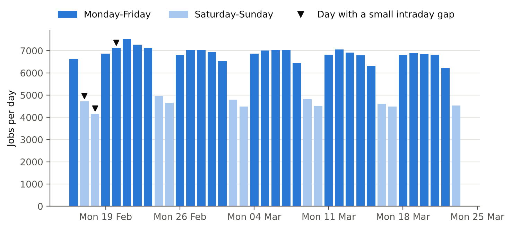
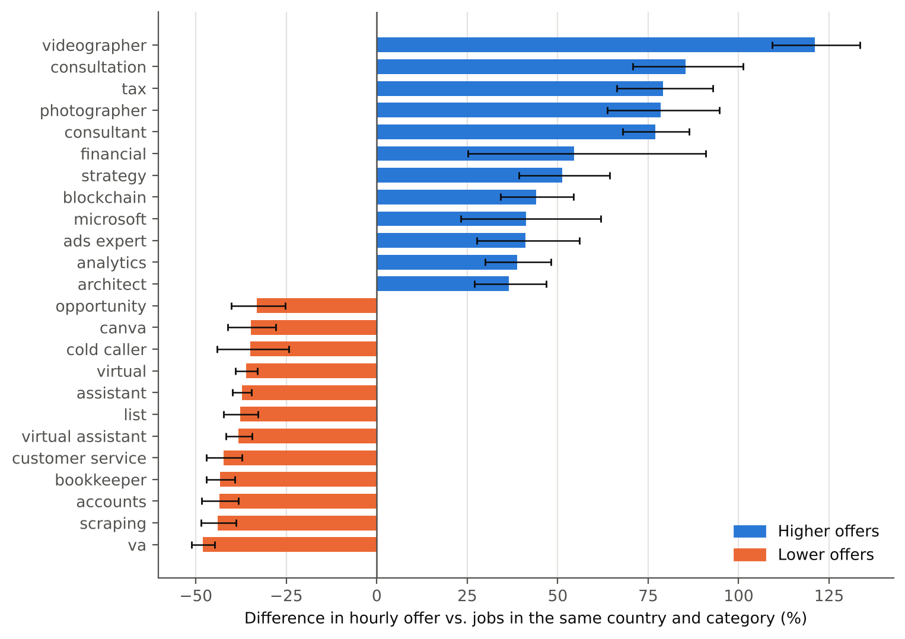
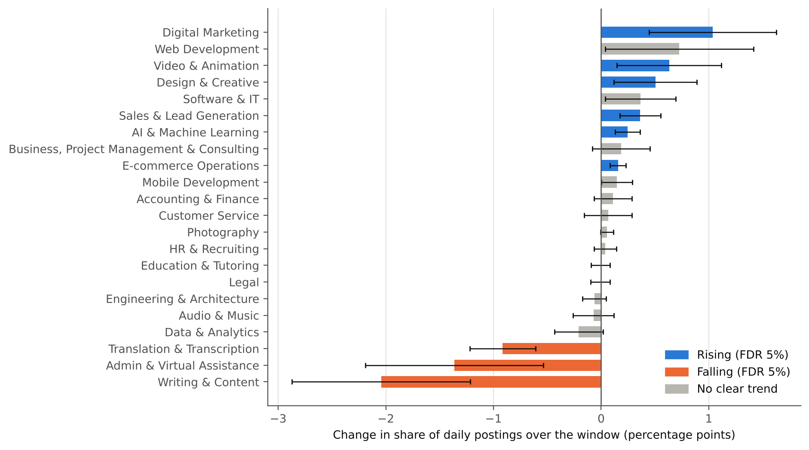
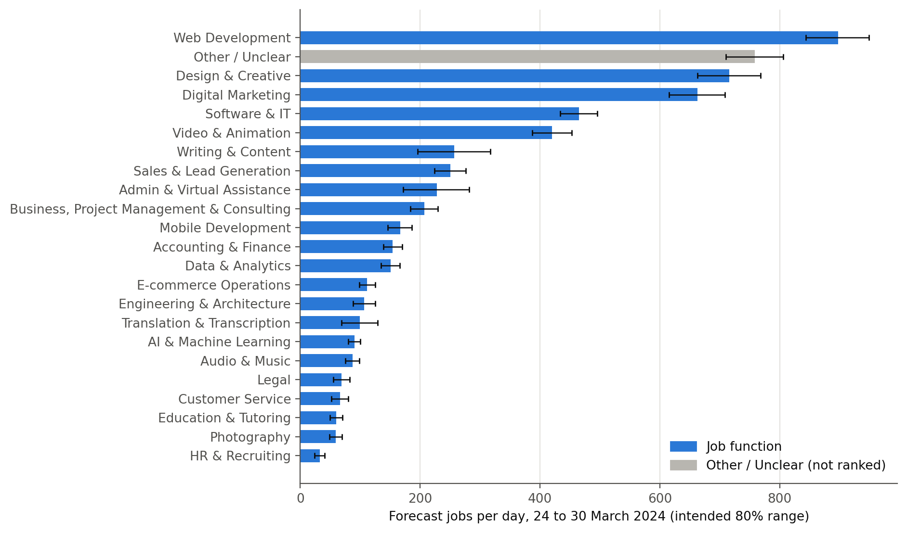
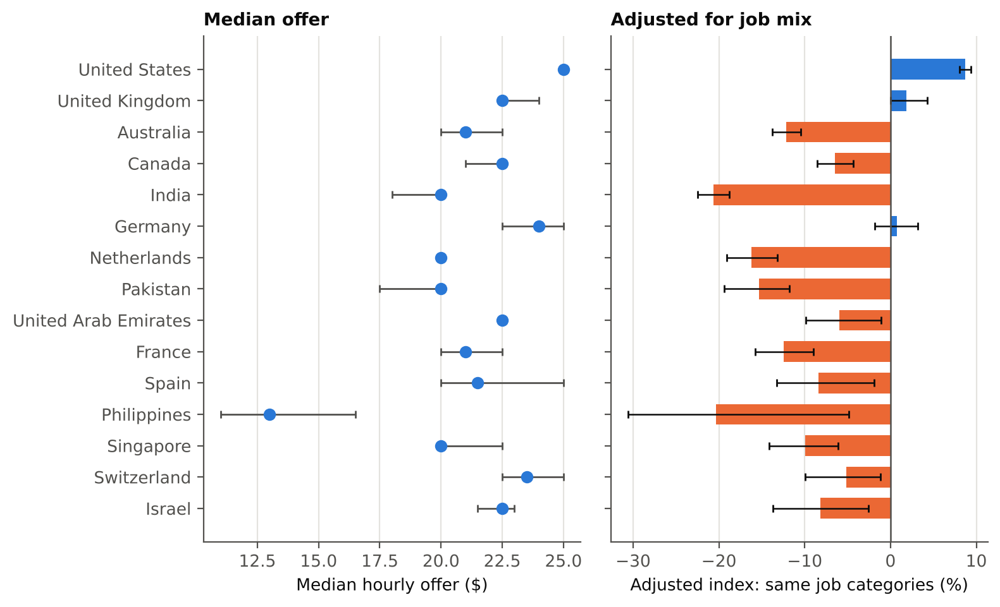
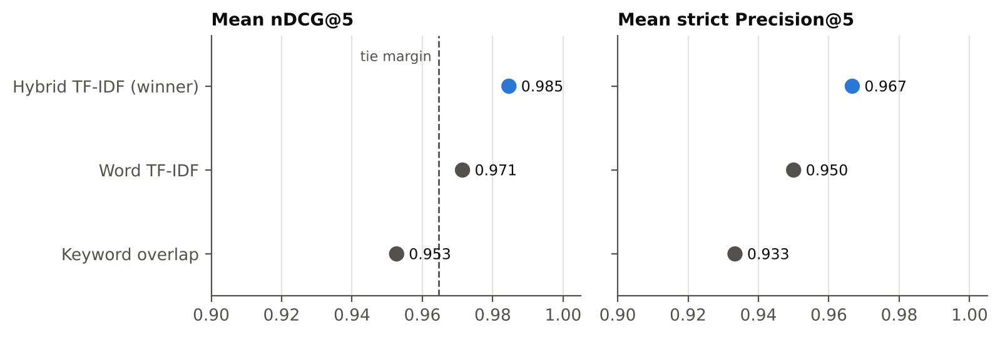
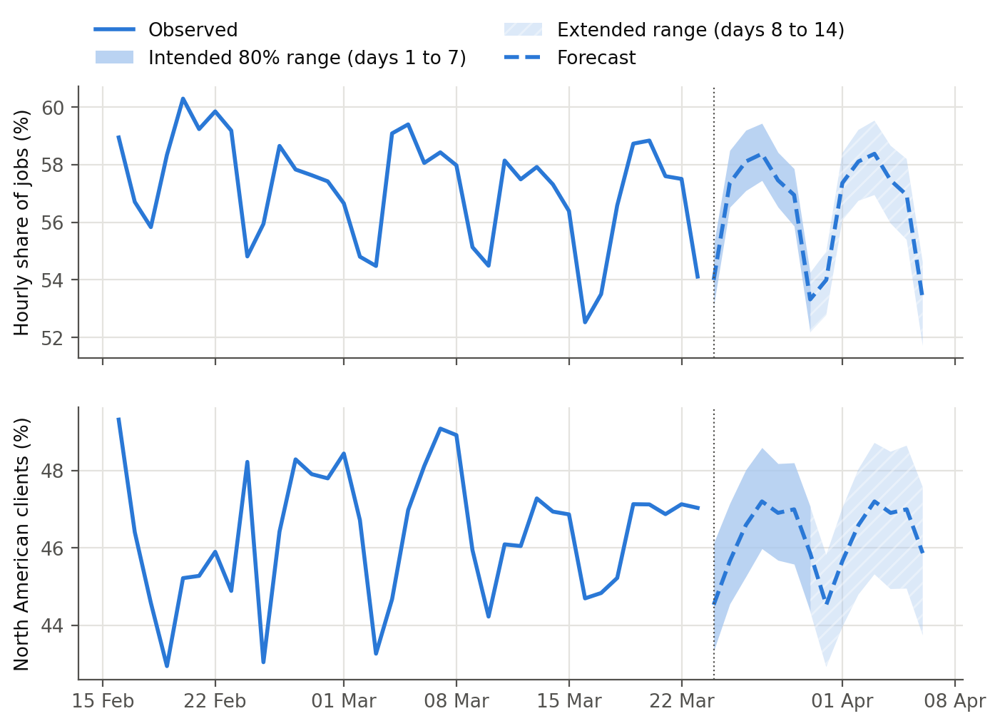
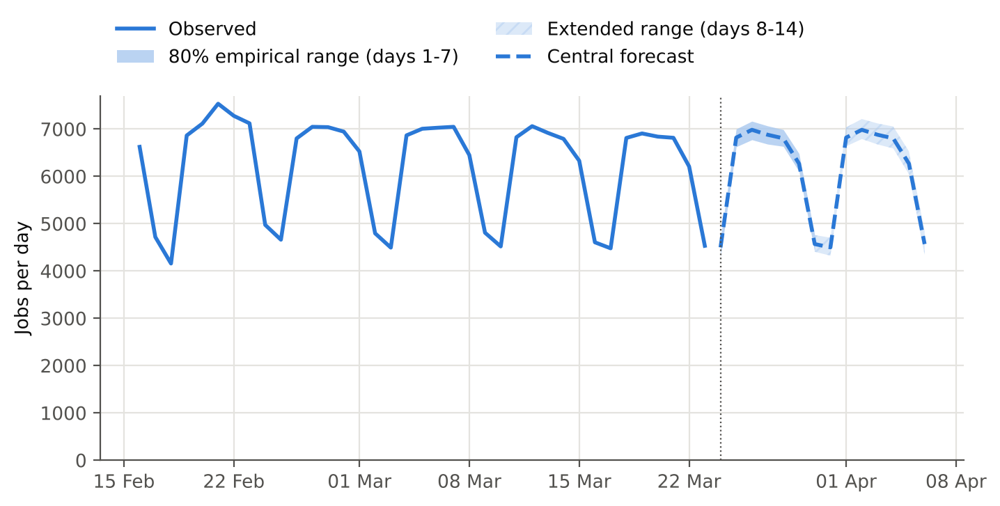

# Job Market Analysis and Recommendation System

**Final report** · Manisha Nagda · October 2026

Repository: [github.com/manishanagda1997-debug/job-market-analysis](https://github.com/manishanagda1997-debug/job-market-analysis)

**Contents**

1. Executive summary
2. Data and project scope
3. Data quality and methodology
4. Task 1: Keywords and pay
5. Task 2: Emerging job categories
6. Task 3: High-demand role forecasting
7. Task 4: Client-country hourly rates
8. Task 5: Recommendation engine
9. Task 6: Monthly market dashboard
10. Task 7: Online and remote hiring landscape
11. Task 8: Future job-market outlook and scenarios
12. Engineering and reproducibility
13. Tools and technology choices
14. Practical implications
15. Limitations
16. Conclusion

## 1. Executive summary

This report analyses 244,828 Upwork job postings, mostly from February and March 2024. Results over time use the reliable 37-day window from 16 February to 23 March 2024, which contains 229,520 jobs. The data includes job titles, rates, budgets, contract types and client countries, but no job descriptions. One pipeline produces the analysis results, and each analysis notebook checks selected reported figures against the saved outputs.

**Task 1: Do title keywords relate to offered pay?**
Of 322 frequent title keywords, 206 (64%) are linked with significantly higher or lower hourly offers, even among jobs from the same client country and job category (false discovery rate 5%). These are associations, not causes.

- **Higher offers:** titles containing words such as "consultant", "tax", "financial", "strategy" and "videographer". For example, titles with "consultant" offer about 77% more than comparable jobs.
- **Lower offers:** titles with "virtual assistant" (about 38% less), "customer service", "lead generation" and "Canva".

Title words explain about a quarter of the variation in hourly offers.
*Limit:* these are offers in postings, not earnings. A title word may also be linked with other factors that the data does not include.

**Task 2: Which job categories are emerging?**
Within the window, 9 of 22 job functions change their share of postings significantly.

- **Gaining share:** Digital Marketing (+1.0 percentage points, +10%), Video & Animation, Design & Creative, Sales & Lead Generation, E-commerce Operations, and AI & Machine Learning.
- **Losing share:** Writing & Content (from 5.8% to 3.7% of postings, −35%), Admin & Virtual Assistance (−1.4 percentage points) and Translation & Transcription (−0.9 percentage points).

All nine directions hold without possible reposts, without days with collection gaps, and in a complete-week comparison, although the sizes vary between these checks. Part of the change is a step around 26 February. After it, Writing & Content keeps falling, and AI & Machine Learning, Sales & Lead Generation and E-commerce Operations keep rising.
*Limit:* five weeks show short-term shifts, not long-run trends. The categories agree with blind human labels for 68.9% of titles.

**Task 3: Which roles will be in high demand?**
Web Development, Design & Creative and Digital Marketing have the highest expected demand for the next week, at about 900, 720 and 660 jobs a day. The ranges of Design & Creative and Digital Marketing overlap, so their order is not certain. The forecast uses a weekday-mean model, chosen before the final test because it has the lowest average seasonal MASE in the development backtests. In the reserved final week, it performs better than the seasonal baseline for 20 of 23 category series (mean Relative MAE 0.84). For total jobs, the baseline performs better in both the development backtests and the final week.
*Limit:* five weeks of history and one week of final testing.

**Task 4: How do hourly rates differ by client country?**
91 client countries have at least 30 jobs with a complete hourly range. Among large markets, the United States has one of the highest typical hourly offers. Its median is USD 25 per hour and its mean is USD 32.6 per hour. The mean is higher than the median in 89 of the 91 countries, which shows how high offers affect the averages. After accounting for job-category mix, the United States has an adjusted index about 9% above the overall reference level. An interactive map shows the country results.
*Limit:* the rate is the midpoint of the range the client states, not what freelancers earn. Small countries have wide uncertainty.

**Task 5: Can we recommend relevant jobs from a freelancer's skills?**
Yes. A working web page and JSON API recommend jobs from the last 14 days of postings (82,565 jobs after keeping only the newest of possible reposts). They offer strict pay filters, similar jobs and related market keywords.

A blind pooled relevance check compares three matching methods across 12 freelancer profiles; the method behind each job stays hidden during labelling. Under the scoring rule fixed before evaluation, the hybrid word-and-character TF-IDF method is selected: nDCG@5 is 0.985 and strict Precision@5 is 0.967, compared with 0.953 nDCG@5 for simple keyword matching. It has one more relevant result than word TF-IDF in the 60 evaluated slots, so the margin is small. The app serves this method under a recorded approval.
*Limit:* matching uses titles only, and 12 profiles is a small evaluation.

**Task 6: How can market changes be tracked month by month?**
A dashboard shows, for each observed month:

- headline numbers, and weekly volume and category shares;
- the tested category trends;
- pay keywords and the country map;
- forecasts and online-hiring signals.

It updates through a fixed chain: a new monthly extract → pipeline rebuild → updated monthly tables → updated dashboard. In the current data, both months are partial. Weekday-standardised volume moves from 6,348 jobs a day in February to 6,171 in March (−2.8%). This is a descriptive change, not a tested trend.
*Limit:* there is no live data feed, and only two partial months exist so far.

**Task 7: What is changing in online and remote hiring?**
The dataset has no structured remote or on-site field, so it cannot measure the share of remote jobs. Explicit work-arrangement wording is rare: remote or home wording appears in 1,260 of 229,520 postings (0.55%), time-zone requirements in 199 (0.09%) and on-site or in-person wording in 171 (0.07%). The title-wording audit estimates that 91% of remote or home matches are correct, with a 95% interval from 85% to 95%. This measures how well the wording rule identifies matching titles. It does not measure the percentage of jobs that allow remote work. The signals the data can measure are mostly stable:

- **Client geography:** about 46% of jobs with a known client country come from North America, and the client base is as concentrated as about 5 equally sized countries.
- **Hourly and fixed-price work:** the hourly share falls from 58.3% to 56.1%, a significant change of −2.2 percentage points.

The forecasts place all three signals close to their recent levels over the next two weeks.
*Limit:* title wording shows how jobs are advertised, not where the work happens.

**Task 8: What does the near future look like?**
The central forecast is about 6,100 jobs per day during the next week. The intended 80% range is approximately 5,930 to 6,300 jobs per day. It uses past forecast errors; in the reserved final week, ranges built the same way contain 75.0% of the actual demand values.

A separate damped-trend model suggests small increases for Digital Marketing, Video & Animation, Business, Project Management & Consulting, and Design & Creative. However, later observed trends do not clearly support continued increases for three of these categories. These are possible short-term directions, not established trends.

*Limit:* the analysis covers five weeks of history. The forecast ranges do not guarantee 80% coverage, and the extended second-week ranges have no separate coverage test.

**Engineering.** The project provides commands to rebuild the results, run the notebooks and check their consistency. The work is checked through:

- six input fingerprints, output hashes and a lineage check; two rebuilds of the official build give byte-identical analytical outputs;
- more than 500 automated tests and continuous integration on every push;
- SQL that recomputes selected results and matches all 1,358 compared values;
- Docker deployment with Nginx, Gunicorn and Flask.

### Key numbers

Each number in this table is checked against the committed result tables by `tests/test_report.py`.

<!-- key-numbers:start -->
| Area | Result | Evidence |
|---|---|---|
| Data | 244,828 postings; 229,520 jobs in the reliable 37-day window (16 Feb to 23 Mar 2024) | Notebook 01 |
| Task 1: pay words | "consultant" about +77% and "virtual assistant" about -38% against jobs in the same country and category | Notebook 04 |
| Task 2: emerging categories | 9 job functions change share significantly; Writing & Content falls from 5.8% to 3.7% of postings (-35%) | Notebook 05 |
| Task 3: high demand | Web Development, Design & Creative and Digital Marketing lead the next week at about 900, 720 and 660 jobs a day | Notebook 06 |
| Tasks 3 and 8: forecast test | The weekday mean beats the seasonal baseline for 20 of 23 category series in the reserved final week (mean Relative MAE 0.84); the baseline performs better for total jobs | Notebook 06 |
| Task 4: countries | 91 client countries with at least 30 rated hourly jobs; United States median USD 25 per hour, mean USD 32.6, adjusted index +9% | Notebook 04 |
| Task 5: recommender | Hybrid TF-IDF: nDCG@5 0.985, strict Precision@5 0.967 over 12 blind-labelled profiles; one more relevant result than word TF-IDF in 60 evaluated slots | Notebook 07 |
| Task 5: candidate pool | 82,565 jobs in the 14-day pool after keeping the newest posting of each possible-repost chain | Notebook 07 |
| Task 6: dashboard | Weekday-standardised volume 6,348 jobs a day in Feb 2024 and 6,171 in Mar 2024 (-2.8%) | Dashboard |
| Task 7: online hiring | Hourly share falls from 58.3% to 56.1% over the window; remote or home wording in 1,260 of 229,520 postings | Notebook 05 |
| Task 8: outlook | Central outlook about 6,100 jobs a day; 80% range 5,930 to 6,300 for days 1 to 7; ranges built the same way contain 75.0% of final-week demand values | Notebook 06 |
| Job categories | 68.9% agreement with blind human labels (241 of 350 titles) | Notebook 03 |
| SQL cross-checks | 8 SQL queries and 2 extra SQL checks match all 1,358 compared pipeline values | Notebook 08 |
<!-- key-numbers:end -->

## 2. Data and project scope

The source is the Upwork job-postings file supplied with the assignment: 244,828 rows and 8 columns. Each row is one job posting. The columns are the title, the link, the posting time, whether the job is hourly, the low and high hourly rate, the fixed-price budget, and the client's country. There are no job descriptions, skills lists, freelancer data or final contract values, so every result describes what the client writes in the title and offers in the posting.

| Item | Value |
|---|---|
| Rows | 244,828 |
| Valid job rows | 244,827 |
| Hourly / fixed-price postings in the raw data | 140,937 / 103,891 |
| Postings with a client country | 98% (212 countries) |
| Distinct cleaned titles | 205,289 |
| Exact duplicate rows | 0 |
| Reliable time-series window | 16 February to 23 March 2024 (37 days, 229,520 jobs) |

One row has no title, link or country, so it does not meet the valid-job rule and is excluded from analysis. Each analysis then uses the eligible subset needed for that question.

The postings run from November 2023 to March 2024, but collection is thin before mid-February and the last day is cut off. I compare each day's volume with the median for the same weekday. A day with less than 90% of that median is incomplete. The primary time-series window runs from 16 February to 23 March. Every day in this window meets the daily-volume rule, while 17, 18 and 20 February still carry small intraday-gap flags and stay in sensitivity checks. Days outside the window are incomplete. All time-based analyses use this 37-day window. Among the 244,827 valid jobs, 15,307 fall outside it and remain available for analyses that do not depend on time.

*Figure 1. Jobs per day, 16 February to 23 March 2024. The weekly cycle is strong: Monday to Thursday have about 6,800 to 7,100 jobs a day, Saturday about 4,700 and Sunday about 4,500. The window has six Fridays and Saturdays but five of every other weekday, so I compare periods using averages per day rather than raw totals.*

**Evidence:** Notebooks 00 and 01; `raw_column_profile.csv`, `raw_daily_coverage.csv`, `day_quality.csv`.

## 3. Data quality and methodology

**Cleaning.** I never change or delete the original values. The cleaned master table adds new columns next to them:

- **Titles:** 10,130 titles contain HTML codes (such as `&amp;`) and 208 contain garbled characters from a wrong text encoding. I repair both in a cleaned title and keep the raw title.
- **Pay:** hourly and fixed-price fields never mix, and no range is inverted. About 27% of hourly jobs state no rate; I do not fill these gaps. Hourly pay is the midpoint of a complete stated range. Values at or above the 99.9% quantile (USD 500 per hour and USD 100,000 budgets) include likely placeholders such as USD 999 per hour, so I flag them and report pay results with and without them.
- **Repeats:** a title can appear again because a posting may be repeated or because several clients post similar jobs. I flag a *possible repost* only when the title, country, contract type and exact pay all match a posting from the previous 3 days (9,190 jobs). I never delete these jobs; I use the flag for sensitivity checks.
- **Eligibility:** each analysis uses a stated subset. For example, hourly pay uses only jobs with a complete range, and trends use only the 37-day window.

**Job categories.** The data has no category field, so I build one. Every job gets exactly one primary category: one of 22 job functions, or *Other / Unclear*. Keyword rules assign categories to 86.6% of jobs. A TF-IDF logistic-regression classifier, trained on titles the rules label, assigns another 1.2%. It decides only when its confidence reaches 0.70, and only in the 14 categories where it passes a reliability check on titles it does not see in training. The remaining jobs receive *Other / Unclear*.

I test the categories against my own human labels in two sets:

- 150 development titles, which I label and then use to tune the rules (83.3% agreement after tuning);
- 350 blind titles, a random sample I draw before any tuning. I label them without seeing the system's predictions; the label sheet shows only the title. The categorizer stays frozen, and I score this set once.

On the blind set, the system agrees with my label for 68.9% of titles (241 of 350; 95% interval 63.8% to 73.5%). When it names a category rather than *Other*, it agrees 77.2% of the time. On the blind set, the system chooses *Other / Unclear* for 13.4% of titles; I choose it for 6.3%. Software & IT, AI & Machine Learning, Engineering & Architecture and Admin & Virtual Assistance have low recall (31% to 46%), so their observed shares are likely to be understated. Every later result that uses categories inherits this uncertainty, and I show the *Other* share next to category results.

**Statistical rules used throughout.**

- **Multiple testing:** when I test many keywords or categories at once, I use the Benjamini-Hochberg false discovery rate (FDR) at 5%. This controls the expected share of false positives among the results called significant.
- **Repeated titles:** for pay, standard errors are clustered by title, so many postings of the same title do not count as independent evidence.
- **Trends over time:** standard errors use Newey-West with a 7-day lag, which allows for days that are not independent. I fix the lag before seeing any result. The p-values rely on a large-sample approximation, so Task 2 also reports a check with a t-distribution.
- **Sensitivity checks:** for the main pay and trend analyses, I repeat the results under alternative reasonable choices, such as removing possible reposts, removing the three gap days and, for pay, removing extreme values.
- **Fixed rules first:** I fix model choices, thresholds and evaluation rules before the final evaluation, and I run the final evaluation once.

**Evidence:** Notebooks 01, 02 and 03; `cleaning_log.csv`, `eligibility_counts.csv`, `label_evaluation_summary.csv`, `docs/decisions.md`.

## 4. Task 1: Keywords and pay

**Question.** Which words in job titles go with higher or lower offered pay?

**Method.** I take words and two-word phrases from the cleaned titles and keep those with at least 300 jobs with a complete hourly range and at least 100 different titles: 322 keywords. For each keyword I model log hourly pay in three layers:

1. **Raw:** keyword only.
2. **Country-adjusted:** the regression gives each client country its own baseline, so differences in country mix do not drive the keyword result.
3. **Country-and-category-adjusted:** each combination of country and job category gets its own baseline, so the keyword is compared with jobs in the same country and job function.

**The third layer is the most adjusted comparison, but it is not the only useful answer.** Category itself comes from the title, so controlling for it removes part of the title signal. I therefore show all three. Fixed-price budgets get the same analysis separately (`pay_keywords_budget.csv`); hourly rates and budgets are never mixed.

**Results.** 206 of the 322 keywords (64%) remain significant in the third layer (FDR 5%).

| Title word | Raw difference | Same country and category |
|---|---|---|
| consultant | +84% | +77% (95% interval +68% to +86%) |
| virtual assistant | −62% | −38% (−42% to −34%) |
| python | +10% | −7.5% |
| blockchain | +74% | +44% |

- **Higher offers:** consulting and specialist words, such as "consultant", "consultation", "tax", "financial", "strategy" and "videographer".
- **Lower offers:** assistant and volume-work words, such as "virtual assistant", "customer service", "lead generation" and "list". Common platform skills are also lower than similar jobs: "Shopify", "WordPress" and "Flutter" by 8% to 13%, and "SEO", "Excel" and "Canva" by 19% to 35%.
- **Adjustment changes the result for some words.** "Python" looks 10% higher in the raw comparison but 7.5% lower after country and category adjustment. This sign change shows that the raw association depends strongly on the mix of job categories. "AI" is 19% higher in the raw comparison, but the difference is not significant after adjustment.

*Figure 2. Difference in hourly offers for jobs whose title contains the word, compared with jobs from the same client country and category. Black lines show 95% intervals; only significant words (FDR 5%) are shown, the 12 strongest in each direction.*

**How much do titles explain?** On a 20% test split where no title appears in both training and test, country and category alone explain about 11% of the variation in log hourly offers. Adding title words raises this to about 26%, with a median error of about USD 8 per hour. So title words add useful information, but the model still leaves most of the variation in hourly offers unexplained. The keyword results are stable across four alternative analysis choices: without extreme rates, without possible reposts, and using the low or high end of each range. Each has a correlation of at least 0.96 with the main result, and at least 93% of keywords keep the same direction.

*Limit:* these are associations, not causes. A title word may also be linked with other factors that are not included in the data. Pay is what clients offer, not what freelancers earn.

**Evidence:** Notebook 04 (Task 1); `pay_keywords_hourly.csv`, `pay_keywords_budget.csv`, `pay_keyword_sensitivity.csv`, `pay_prediction.csv`.

## 5. Task 2: Emerging job categories

**Question.** Which job categories gain or lose ground over time?

**Method.** For each of the 22 job functions, I calculate its share of each day's postings in the 37-day window. A share is better than a count here, because total volume changes with the weekday. I fit a straight-line trend with weekday effects and report the change across the window in percentage points and in relative terms, with Newey-West intervals and FDR-adjusted p-values. *Other / Unclear* is monitored separately, not tested as a category. I then check every significant result three ways: without possible reposts, without the gap days, and comparing the first two with the last two complete weeks.

**Results.** 9 of the 22 functions change significantly.

| Function | Share at start → end of window | Change in points | Relative change |
|---|---|---|---|
| Digital Marketing | 10.0% → 11.0% | +1.0 | +10% |
| Video & Animation | 6.5% → 7.1% | +0.6 | +10% |
| Design & Creative | 11.4% → 11.9% | +0.5 | +4% |
| Sales & Lead Generation | 3.7% → 4.1% | +0.4 | +10% |
| AI & Machine Learning | 1.3% → 1.5% | +0.25 | +19% |
| E-commerce Operations | 1.7% → 1.8% | +0.16 | +9% |
| Translation & Transcription | 2.3% → 1.3% | −0.9 | −41% |
| Admin & Virtual Assistance | 4.8% → 3.4% | −1.4 | −29% |
| Writing & Content | 5.8% → 3.7% | −2.0 | −35% |

*Start and end shares come from the fitted trend line and are rounded separately, so a difference can be off by 0.1 point.*

- **The directions hold in every check.** All nine categories keep their direction without possible reposts, without the gap days and in the complete-week comparison. The sizes vary between checks, so I read them as ranges, not exact values. For example, Writing & Content falls 35% in the trend line and 19% in the complete-week comparison.
- **Part of the change is a step, not a smooth trend.** Around 26 February several shares shift at once. A separate trend analysis from 26 February to 23 March finds clear changes for four categories: Writing & Content falls (−13%), while AI & Machine Learning (+13%), Sales & Lead Generation (+9%) and E-commerce Operations (+7%) rise. Admin & Virtual Assistance, Translation & Transcription, Digital Marketing, Video & Animation and Design & Creative do not show clear trends over this later period. The split date comes from examining the daily chart, so this is an exploratory analysis.
- **Title keywords show the same pattern.** "Writers", "data entry", "translation", "writing" and "documents" lose about half or more of their share, while "crypto" nearly doubles (+97%).
- **No sign of changing classification coverage.** The share of *Other / Unclear* stays near 12.5%, so changes in this group do not appear to explain the main trends. However, errors within the named categories may still affect the results.
- **The category results remain the same under an alternative p-value calculation.** Using a t-distribution with 29 degrees of freedom, the same 9 of 22 categories remain significant. For title keywords, the number falls from 138 to 116 of 726, so some keyword findings depend on the calculation used.

*Figure 3. Change in each function's share of daily postings over the window, with 95% Newey-West intervals. Blue: significant rise; orange: significant fall; grey: no clear trend after the FDR adjustment. The intervals are not adjusted for multiple testing, so a grey bar can have an interval that just excludes zero (Web Development, Software & IT and Mobile Development).*

*Limit:* five weeks show short-term shifts in what clients post, not long-run industry trends. Category results carry the 68.9% blind agreement from Section 3.

**Evidence:** Notebook 05 (Task 2); `trend_categories.csv`, `trend_category_daily.csv`, `trend_keywords.csv`, `trend_other_monitor.csv`.

## 6. Task 3: High-demand role forecasting

**Question.** Which job functions will have the most postings in the near future?

**Method.** The reliable history is only 37 days, so I forecast a short horizon of 14 days (24 March to 6 April 2024). Days 1 to 7 are the main forecast; days 8 to 14 are an extended outlook with more uncertainty. I split the history into two parts:

- **Development period (first 30 days):** I compare four models fixed in advance: a seasonal baseline (the same weekday last week), a weekday mean (the average of the last 14 days for each weekday), a straight trend with weekday effects, and a damped trend. A rolling backtest makes 7-day forecasts from ten starting points. The rule picks the model with the lowest average seasonal MASE, one model for the whole family of demand series (total jobs plus the 23 category shares).
- **Reserved final week (last 7 days):** these days are not used for fitting or model choice. I score this window once, after the rule chooses the model. The trend analysis in Task 2 already describes all 37 days, so I call this a reserved final evaluation window rather than a blind test.

Category forecasts are total jobs multiplied by the forecast category shares, so the 22 functions plus *Other* always add up to the total.

**Forecast ranges.** Each forecast has an intended 80% range. For days 1 to 7, the range comes from the selected model's errors in the development backtests. Each error is divided by its series' usual week-to-week change, so errors from large and small series can be pooled, and the 10th and 90th percentiles form the range. These ranges reflect errors observed in the development backtests. They do not separately account for uncertainty in model selection, changes in the market or events outside the data. For days 8 to 14, the day 7 range is widened by the square root of (forecast day ÷ 7). This is a fixed assumption, because only three backtests give full two-week errors.

**Model choice.** The weekday mean has the lowest average seasonal MASE in development: 0.77, against 0.82 for the damped trend, 0.84 for the straight trend and 0.86 for the seasonal baseline. Relative MAE gives a less favourable result. The weekday mean averages 1.01, about 1% worse than the baseline and level with the damped trend. It beats the baseline in 17 of the 23 category series, but it is much worse for Writing & Content, Admin & Virtual Assistance, AI & Machine Learning and Translation & Transcription, where the change around 26 February may contribute. For total jobs its Relative MAE is 1.52. A secondary 14-day check from three starting points gives the same winner on MASE, but its Relative MAE for demand is 1.04.

**Final-week result.** The weekday mean performs better than the seasonal baseline for 20 of the 23 category series (mean Relative MAE 0.84; below 1 means better than the baseline). The exceptions are Video & Animation, Accounting & Finance and HR & Recruiting. For total jobs the baseline performs better, as it does in development: the weekday mean's mean absolute error is 112 jobs a day, against 72 for the baseline. Across all 24 demand series in the final week, the damped trend has a slightly lower average seasonal MASE than the weekday-mean model (0.828 compared with 0.836). The selected model remains unchanged because its selection depends only on the development backtests.

**Range coverage.** Ranges rebuilt from the development period alone contain 126 of 168 final-week demand values (75.0%), below the intended 80%. Coverage varies by series, from 2 of 7 days for Data & Analytics to 7 of 7 for total jobs and four categories. Days within a series are related, so this is one small check, not proof of future coverage.

**Outlook for the next 7 days.**

| Rank | Function | Forecast jobs a day | 80% range |
|---|---|---|---|
| 1 | Web Development | about 900 | 844 to 949 |
| 2 | Design & Creative | about 720 | 663 to 769 |
| 3 | Digital Marketing | about 660 | 616 to 709 |
| 4 | Software & IT | about 465 | 434 to 496 |

*Other / Unclear* sits at about 760 jobs a day, between first and second place, and is not ranked as a function. The ranges of Design & Creative and Digital Marketing overlap, so I treat them as similarly high-demand rather than as a clear second and third. Software & IT is likely to be understated, because many of its titles fall into *Other* (Section 3).

*Figure 4. Forecast jobs a day for each function over the next 7 days, with intended 80% ranges. Overlapping ranges mean similar demand.*

*Limit:* five weeks of history and one week of final testing. The forecast assumes the recent weekly pattern continues; it cannot see events, seasons or platform changes outside the data.

**Evidence:** Notebook 06; `forecast_model_choice.csv`, `forecast_backtest_by_series.csv`, `forecast_backtest_14d.csv`, `forecast_final_evaluation.csv`, `forecast_final_coverage.csv`, `forecast_demand_outlook.csv`, `forecast_demand_daily.csv`.

## 7. Task 4: Client-country hourly rates

**Question.** How do offered hourly rates differ by the client's country?

**Method.** Hourly pay is the midpoint of a complete stated range. I include every client country with at least 30 such jobs: 91 countries. For each one I report three numbers:

- **Median offer:** the typical rate, with a bootstrap interval that resamples titles, not single postings.
- **Mean offer:** the average rate, with the same kind of interval. The brief asks for average rates, so the mean is shown next to the median. The median stays the main measure, because a small number of very high offers pulls the mean upwards.
- **Adjusted index:** how much a country's clients offer compared with the average client *for the same job categories*. This helps show how much of the difference in hourly offers is linked to the types of jobs posted in each country.

**Results.**

| Client country | Jobs | Median offer | Mean offer | Adjusted index |
|---|---|---|---|---|
| United States | 46,620 | USD 25.00 | USD 32.58 | +9% |
| United Kingdom | 8,113 | USD 22.50 | USD 29.49 | +2% |
| Australia | 5,682 | USD 21.00 | USD 24.46 | −12% |
| India | 4,337 | USD 20.00 | USD 23.67 | −21% |
| Philippines | 902 | USD 13.00 | USD 30.54 | −20% |

- **US clients have the highest median among the largest markets.** Among countries with at least 2,000 rated jobs, the United States has the highest median, USD 25 per hour, and an adjusted index about 9% above the reference level. Its mean is USD 32.6 per hour (95% interval USD 32.0 to USD 33.2), or USD 31.5 without flagged extreme rates.
- **The mean and the median tell different stories.** The mean is above the median in 89 of the 91 countries, and the two measures rank countries differently (rank correlation 0.57). The Philippines shows the gap most clearly: a median of USD 13 but a mean of about USD 31 (95% interval USD 22 to USD 40), because a small number of very high offers raises the average.
- **The UK, Germany and Switzerland are close to average** once job mix is taken into account (within ±6%).
- **Job mix matters.** Australia's median is close to the overall typical rate, but its adjusted index is about 12% below average after accounting for job-category mix. India and the Philippines are about 20% below average after adjustment.
- South Korea, Japan and Taiwan have adjusted indexes 28% to 48% below average.

**Stability.** Country rankings by median hardly change without extreme rates or without possible reposts (rank correlation at least 0.96). They change more if I use the high end of each range (0.90) or the low end (0.69), so the ranking of mid-sized countries at the low end is less certain.

*Figure 5. Median hourly offer and category-adjusted index for the client countries with the most rated jobs. The interactive world map is in Notebook 04 and on the dashboard.*

*Limit:* rates are offers, not earnings, and many hourly jobs state no rate. Rates cluster at round numbers, so some median intervals collapse to a single value. Countries near the 30-job minimum have wide uncertainty.

**Evidence:** Notebook 04 (Task 4); `pay_countries.csv`, `pay_country_sensitivity.csv`.

## 8. Task 5: Recommendation engine

**Question.** Can a freelancer type their skills and get relevant jobs from the available postings?

**What it does.** A freelancer enters skills separated by commas. By default, the engine searches jobs from the last 14 days; the interface also allows 7 days, 30 days or all available jobs. The fixed evaluation uses the 14-day pool. The engine returns the 10 best-matching jobs, with pay shown as the client states it, for example `$15–$35/hr` in the application.

The filters are strict. For an hourly filter, a job passes when the upper end of the client's stated hourly range reaches the requested minimum. This does not mean the client offers that amount as the starting rate. A job with only one stated rate uses that rate, and a job that states no hourly rate never passes. For fixed-price work, the stated budget must meet or exceed the requested minimum. Hourly rates and fixed-price budgets are never compared with each other. Each result offers 5 similar jobs. A side panel shows related market keywords when the evidence from Tasks 1 and 2 supports one.

**Design choices.**

- **Candidate pool:** 85,635 jobs from the last 14 days. I keep only the newest posting of each possible-repost chain, which leaves 82,565 jobs.
- **Diversity:** at most one result per title, unless too few different titles match, so the list does not show the same job ten times.
- **Matching methods:** I build three methods, from simple to complex: keyword overlap, word TF-IDF, and a hybrid of word and character TF-IDF. Character pieces help with spelling variants and different word forms.

**Evaluation.** I write 12 freelancer profiles covering different kinds of work. For each profile, I combine the top five results from all three methods into a pool of titles for blind labelling. The method behind each result is hidden during labelling. I label each title 0 (not relevant), 1 (partly relevant) or 2 (relevant), and only then compute the scores. The scoring rule stays fixed before evaluation:

1. The main score is nDCG@5 against the best possible ranking of everything judged for that profile.
2. If two methods differ by less than 0.02, they count as tied, and strict Precision@5 decides (only label 2 counts).
3. If they are still tied, the simpler method wins.

| Method | Mean nDCG@5 | Strict Precision@5 |
|---|---|---|
| Keyword overlap | 0.953 | 0.933 |
| Word TF-IDF | 0.971 | 0.950 |
| **Hybrid TF-IDF (winner)** | **0.985** | **0.967** |

The hybrid and word TF-IDF methods are within the 0.02 tie margin, so strict Precision@5 decides. The hybrid has 58 results labelled relevant in the 60 evaluated slots, word TF-IDF 57 and keyword overlap 56, so one result separates the two TF-IDF methods. Keyword overlap is outside the tie margin. All three methods score highly: seven of the 12 profiles are perfect for every method. The fixed rule selects a winner, but the small differences do not show that one method is generally better.

**Product checks.** For every profile and every filter setting (no filter, at least USD 30 per hour, at least USD 50 per hour, fixed price at least USD 500), every method returns a full list of 10 different titles, with no filter violations and no job from outside the pool. The smallest candidate pools are 9,686 jobs at a minimum of USD 50 per hour and 6,707 jobs with a fixed budget of at least USD 500.

**Related keywords.** A keyword appears only if it has a significant pay or growth result from Tasks 1 or 2, appears in at least 3 of the 50 best matches, is not a generic word, and is at least twice as common in the matches as in the whole pool. Only two profiles get a keyword ("react" and "design"); the other ten get none. An initial check returns generic words such as "expert" and "help", so I add the generic-word rule and the "twice as common" rule once. I do not tune the feature again after that. This feature is descriptive and separate from the method evaluation.

**Approval for serving.** The Flask app uses the project's recommendation implementation and serves only a method approved in `config/recommender_approval.toml`. The approval records the method, implementation settings and evaluation evidence supporting the decision. If the recommender code or settings change, or a new evaluation selects a different method, the app stops serving recommendations until a person reviews the result. The official build serves the hybrid method with status approved, and its rankings are identical to those of the evaluated build.

**API and interface.** The app offers these addresses:

| Address | Returns |
|---|---|
| `/` | the recommendation page |
| `/api/recommend?skills=…&days=…&contract=…&min_hourly=…&min_budget=…` | 10 jobs, the filters applied in words, related keywords |
| `/api/similar/<row_id>` | the 5 most similar jobs |
| `/api/health` | build ID, method and number of indexed jobs |

Invalid parameters return a 400 error with a plain message; an unknown job returns 404. `docs/api.md` documents every endpoint, parameter, response field and error, with real example responses.

*Figure 6. Mean nDCG@5 and strict Precision@5 for the three methods over 12 blind-labelled profiles. The dashed line marks the 0.02 tie margin below the best nDCG@5.*

*The recommendation page for the skills "python, pandas, sql, power bi dashboards", hourly jobs from USD 30 per hour.*

*Limit:* matching uses titles only. The evaluation has 12 profiles and one judge, and most judged titles are relevant (115 of 122 get label 2). It shows strong title-level relevance on these 12 profiles, but with a margin of one result it cannot separate the methods with high confidence. The postings are from 2024, and there is no click or application data for learning from behaviour.

**Evidence:** Notebook 07; `recommend_relevance_summary.csv`, `recommend_relevance_by_profile.csv`, `recommend_checks.csv`, `recommend_pool_sizes.csv`, `recommend_related_keywords.csv`; `src/job_market_web/`.

## 9. Task 6: Monthly market dashboard

**Question.** How can someone follow changes in the job market month by month?

**What it shows.** The dashboard at `/dashboard` has:

- headline numbers for each observed month: weekday-standardised jobs per day, hourly share, median hourly rate, and the effective number of client countries;
- weekly volume and weekly category shares, with a category selector;
- monthly category shares and the top client countries by month;
- the tested emerging and falling categories (Task 2);
- title words linked with higher or lower offers, and the country map (Tasks 1 and 4);
- the total and category forecasts, and the online-hiring signals (Tasks 3, 7 and 8).

**How it updates.** The dashboard computes nothing itself. It only draws verified tables from the current build:

> new monthly extract → pipeline rebuild → updated monthly and weekly tables → updated dashboard

New months and weeks appear without any code change. An automated test checks this: it builds a synthetic extract that runs into April 2024 and confirms that "Apr 2024 (14 days)" appears in the monthly table and on the page. There is no automatic schedule, because the source has no live feed; a refresh starts when a new extract arrives.

**Fair month comparisons.** A month can be partial, and months have different numbers of each weekday. So I do not compare monthly totals. I compare jobs per day standardised by weekday, and shares. I label partial months with their number of days. Changes between months are descriptive; the tested trends are in Task 2.

**Current data.** Both observed months are partial: February has 14 days and March 23.

| | Feb 2024 (14 days) | Mar 2024 (23 days) |
|---|---|---|
| Jobs per day, weekday-standardised | 6,348 | 6,171 (−2.8%) |
| Hourly share | 58.1% | 57.0% |
| Median hourly rate | USD 22.50 | USD 22.50 |
| Effective number of client countries | 5.25 | 5.19 |

*The top of the dashboard: headline numbers per month, weekly volume and weekly category share.*

*Limit:* only two partial months exist, so month-to-month changes are short and descriptive. The dashboard works offline, but it shows only what the latest build contains.

**Evidence:** web app (`/dashboard`); `monthly_market_summary.csv`, `monthly_category_share.csv`, `monthly_country_share.csv`, `weekly_market_summary.csv`, `weekly_category_share.csv`; `tests/test_dashboard.py`.

## 10. Task 7: Online and remote hiring landscape

**Question.** What is changing in online and remote hiring?

**What the data can and cannot measure.** The dataset has no structured remote or on-site field, so it cannot measure the percentage of jobs that are remote or show a direct shift between office and remote work. Instead, I measure three things the data does contain:

1. **Client geography:** where the clients who post online work are.
2. **Engagement structure:** hourly against fixed-price work, and mentions of long-term, full-time or part-time work.
3. **Explicit work-arrangement wording in titles:** three audited series for remote or home wording, on-site or in-person wording, and time-zone requirements.

**Method.** I use the 37-day window and the same trend method as Task 2: a daily series, a weekday-adjusted straight-line trend, and Newey-West intervals. Countries are grouped into World Bank regions. Concentration uses the Herfindahl-Hirschman index (HHI), turned into an "effective number of countries": 1 / HHI, the number of equally sized countries that would give the same concentration. The wording rules (version 1.0) are written using development labels and then tested once on a separate blind sample of titles (decision D-041).

**Results.**

- **Client geography is stable.** About 46% of jobs with a known client country come from North America, about 24% from Europe & Central Asia, about 11% from East Asia & Pacific, and 9% to 11% from South Asia each week. The client base is as concentrated as about 5.2 equally sized countries. None of these measures shows a trend over the window. About 2% of jobs have no country.
- **Fixed-price work gains slightly.** The hourly share falls from 58.3% to 56.1% over the window, a change of −2.2 points whose interval stays below zero.
- **Engagement words are rare.** "Long-term" or "ongoing" appears in about 1% of titles, and "full-time" and "part-time" in about 0.4% each.
- **Explicit arrangement wording is rare.** Remote or home wording appears in 1,260 of 229,520 postings (0.55%), time-zone requirements in 199 (0.09%) and on-site or in-person wording in 171 (0.07%). A title that describes a hybrid working arrangement counts in both the remote or home series and the on-site series. The weekly figures describe how often this wording appears; no formal trend test is reported for these series.

**How reliable the wording rules are.** I evaluate the rules on a separate sample of titles, excluding titles identified as seen during rule development. This reduces overlap between development and evaluation, although earlier records do not allow complete separation to be proved. 91% of remote or home matches are correct (95% interval 85% to 95%), and 87 of 98 on-site matches are correct (89%). Recall is much less certain. The estimated range for remote or home recall extends from about 10% to 98%, mainly because only a small sample comes from the large group of titles without a rule match. This range is too wide to give a reliable recall estimate. The time-zone rule has no blind precision or recall estimate. Its identified evaluation-side matches are excluded from the main blind sample because they were seen during rule development. They are assessed separately as diagnostic evidence. The audit counts distinct titles, not postings, and it measures the wording rules, not the share of remote jobs.

**Forecasts.** For the three signals with enough data, the same forecasting approach as Task 3 gives:

| Signal | Recent (last 7 days) | Forecast, next 14 days | Direction |
|---|---|---|---|
| Hourly share | 56.7% | 56.5% | no reliable direction |
| North American client share | 46.5% | 46.3% | no reliable direction |
| Effective number of client countries | about 5.2 | about 5.3 | stable |

The chosen model is the weekday mean. In the reserved final week, it beats the seasonal baseline for hourly share, but not for North American share or concentration, where the trend models have lower error in that week. I do not change the selected model after this final check. The errors remain small; for example, the North American share has an error of about 0.9 percentage points. The three wording series are not forecast. They appear in under 1% of titles, and the forecast step does not model them.

*Figure 7. Daily hourly share and North American client share in the window, followed by the 14-day forecast with its intended 80% range for days 1 to 7 and the extended range for days 8 to 14.*

**What this means.** The clearest change in this dataset is the mix between hourly and fixed-price work: fixed-price work gains slightly. Client geography stays stable, and explicit work-arrangement wording is rare, with no formal trend test reported for it. A direct measure of remote work would need a structured remote/on-site field or information from the job descriptions.

*Limit:* this analysis describes online-hiring patterns and explicit title mentions. It does not measure the share of office jobs versus remote jobs. Five weeks show short-term movement only.

**Evidence:** Notebook 05 (Task 7), Notebook 06; `remote_series_trends.csv`, `remote_signals_weekly.csv`, `remote_regions_weekly.csv`, `remote_geography_weekly.csv`, `forecast_signals_outlook.csv`; the wording audit in `reports/arrangement_audit/` and decision D-041 in `docs/decisions.md`.

## 11. Task 8: Future job-market outlook and scenarios

**Question.** What does the job market look like over the next weeks?

I separate three things that are easy to mix up:

1. **Central outlook:** the selected weekday-mean forecast.
2. **Forecast range:** the intended 80% range from past forecast errors (Section 6). It shows the uncertainty around the central forecast; it is not a separate scenario.
3. **Trend-continuation scenario:** for each category, the better of the two predefined trend models in the development backtests projects the recent direction. This does not change the central forecast, which stays the weekday mean. I report a direction only if that model beats the seasonal baseline in development (Relative MAE below 1); otherwise the result is "no reliable direction". A change smaller than 0.1 percentage points is "stable".

**Central outlook and range.**

| Total jobs a day | Central | Forecast range |
|---|---|---|
| Recent (last 7 days) | about 6,084 | not applicable |
| Days 1 to 7 | about 6,117 | 5,926 to 6,302 |
| Days 8 to 14 | about 6,117 | 5,879 to 6,321 |

The central outlook is flat: total demand stays close to recent levels. In the reserved final week, ranges built the same way as the days 1 to 7 range contain 75.0% of the actual demand values, below the intended 80%. The wider range for days 8 to 14 uses the square-root rule from Section 6 and has no coverage test, so I treat it as an extended range, not an empirical interval. For total jobs, the seasonal baseline forecasts better than the weekday mean in both development and the final week, so the total-jobs outlook should be read with that weakness in mind.

**Trend-continuation scenario by category.**

| Direction | Categories |
|---|---|
| **Small rise** (damped-trend model; change in average share over the next 14 days) | Digital Marketing (+0.48 points), Video & Animation (+0.36), Business, Project Management & Consulting (+0.17) and Design & Creative (+0.15) |
| **Stable** (9 categories) | Mobile Development, Software & IT, Photography, Sales & Lead Generation, Accounting & Finance, Legal, Engineering & Architecture, E-commerce Operations, HR & Recruiting |
| **No reliable direction** (10 series) | Web Development, AI & Machine Learning, Data & Analytics, Writing & Content, Translation & Transcription, Admin & Virtual Assistance, Customer Service, Audio & Music, Education & Tutoring, and *Other / Unclear* |

The support for the four rises differs. The damped-trend model beats the baseline clearly for Digital Marketing and Design & Creative (Relative MAE 0.83 each), less clearly for Video & Animation (0.94), and Business, Project Management & Consulting is almost level with the baseline (0.996). The trend line is fitted over all 37 days, including the step around 26 February. A separate trend from 26 February to 23 March shows no clear rise for Digital Marketing, Video & Animation or Design & Creative; for Video & Animation the later estimate is slightly negative (−0.14 percentage points, 95% interval −0.37 to +0.09). The projected rises may partly reflect the step around 26 February rather than a continuing increase. They are possible short-term directions, not established trends.

**How this connects to Task 2.** Task 2 describes change within the observed five weeks. Task 8 asks whether a trend model forecasts the next days better than a simple baseline. The two answers can differ: Writing & Content and AI & Machine Learning move clearly within the window but get "no reliable direction" here, and Sales & Lead Generation keeps rising after 26 February but is "stable" here. A large past change does not guarantee that the same change continues.

*Figure 8. Total jobs a day in the window, followed by the 14-day central outlook: the intended 80% range for days 1 to 7 and the extended range for days 8 to 14.*

*Limit:* a 14-day horizon from five weeks of history. These are statistical scenarios: they cannot see seasonality beyond the week, platform changes or outside events.

**Evidence:** Notebook 06; `forecast_demand_outlook.csv`, `forecast_demand_daily.csv`, `forecast_backtest_14d.csv`, `forecast_final_evaluation.csv`, `forecast_final_coverage.csv`.

## 12. Engineering and reproducibility

I build the project so that anyone can rerun it and check the results.

**One pipeline.** A single command, `python -m job_market rebuild`, runs ten steps in order: ingest, clean, categorize, evaluate, pay, trends, forecast, recommend, monitor and database. Every threshold and path sits in one configuration file, `config/pipeline.toml`, and every analytical decision has a written reason in `docs/decisions.md`.

**A record of each build.** Each rebuild writes a run manifest. It stores six SHA-256 fingerprints, for the raw file, the configuration, the code, the pinned environment, the SQL files and the recorded label inputs, and a hash of every output file. The command `python -m job_market check` then confirms that:

- all six inputs still match the build;
- every output matches its recorded hash, and no stale file exists;
- the recommender approval still fits the implementation;
- every notebook is a clean, top-to-bottom run of the current build.

**Notebooks that cannot drift.** The notebooks use the verified pipeline outputs rather than maintaining a separate analysis pipeline. Each analysis notebook (01 to 08) ends with a claims cell that checks selected reported figures against the saved outputs. If one of these figures no longer matches, the notebook fails.

**Frozen evaluations.** I freeze each evaluation before I calculate its final score:

- Git tags `categorizer-1.0` and `blind-labels-final` freeze the category system and blind labels before the blind score;
- `recommender-1.0` and `relevance-labels-final` freeze the recommender settings and relevance labels before scoring;
- `arrangement-rules-1.0` and `arrangement-labels-final` freeze the work-arrangement wording rules and their audit labels before the audit is scored;
- the configuration fixes the forecast models and model-selection rule before the reserved final week is scored.

**Automated tests and continuous integration.** More than 500 automated tests cover cleaning, categories, pay, trends, forecasts, the recommender, the web app, the dashboard, the database and the Docker setup. Many of them run the whole pipeline on a small synthetic project. On every push, GitHub Actions runs two jobs on a pinned Ubuntu 24.04 runner:

1. **test:** installs the pinned environment in strict mode, runs all tests and checks the committed notebooks;
2. **docker:** validates the Compose file, builds both images, and runs smoke checks on them.

The Docker CI job checks the images and configuration without loading the full dataset. I test the complete application locally with the official build through Docker: the recommendation page, the dashboard and the API, on a computer and on a phone.

**Independent SQL checks.** The pipeline also writes a SQLite database. The eight cross-check queries start from row-level jobs, category predictions, human labels and recommender rankings rather than from pre-calculated summary results. They recompute selected results, including the time window, monthly and weekly volumes, category and country shares, country medians, label accuracy, and the recommender's nDCG@5 and Precision@5. Notebook 08 also recomputes the mean hourly offer by country and the recommender means. All 1,358 compared values match: counts and medians exactly, label accuracy to the four decimals stored by the pipeline, and other decimals within the 6-decimal rounding of the stored tables. SQL reproduces selected aggregations and evaluation metrics; it does not re-verify the whole project, because the cleaned fields, the categories and the rankings come from Python.

**Docker deployment.** Docker Compose defines three services. The normal web deployment runs two of them:

- **Nginx** (web server) is the only service with a public port (8080) and passes requests to the application;
- **Gunicorn + Flask** (application server) runs one worker with four threads, because each worker process would hold its own copy of the large search index.

The application image holds code and the pinned environment only. The verified outputs are mounted read-only, so the website cannot change them. Nginx starts only after the application passes its health check. The application container runs as a non-root user; Nginx uses the standard image, whose worker processes run as the unprivileged `nginx` user. The third service, `pipeline`, runs the data pipeline only when requested and reuses the application image to rebuild all outputs inside Linux.

**The official build.** The results in this report come from build `20261011T132714Z-e537465460`. Two rebuilds with the same recorded inputs produce byte-identical analytical outputs across all 54 files. The run manifests differ because they record separate run IDs and times.

All nine notebooks run in strict mode with the pinned environment. The final project check reports 0 errors and 0 warnings. The build also records the recommender approval reference, linking the served hybrid method to its approval evidence (decision D-040).

**Cross-platform check.** I rebuild the official project outputs inside a Linux Docker container and compare them with the Windows build. All six input fingerprints match. Of the 54 analytical output files, 49 are byte-identical. Two Parquet files contain the same data but differ in their compressed bytes.

Three other files contain small numerical differences. Classifier probabilities differ by at most 0.000016, without changing any assigned category. Three pay-model error measures also differ slightly, including an R² difference of 0.000006. The saved rankings, forecasts and main analysis tables remain unchanged, and every number stated in this report is the same on both builds.

**Evidence:** `src/job_market/`, `config/pipeline.toml`, `data/processed/run_manifest.json`, `tests/`, `.github/workflows/ci.yml`, `sql/`, Notebook 08, `docker/`, `docker-compose.yml`, `docs/decisions.md`.

## 13. Tools and technology choices

| Tool | Where I use it |
|---|---|
| Python, Pandas | The whole pipeline and the notebooks |
| SQL (SQLite) | A row-level database and eight cross-check queries (Notebook 08) |
| scikit-learn | TF-IDF features, the category classifier (logistic regression), the pay model (ridge regression) and the recommender's TF-IDF matching |
| SciPy, NumPy | Statistical tests, regressions and forecasting calculations |
| Matplotlib | Static charts in the notebooks and in this report |
| Plotly | The interactive country map and every dashboard chart, served offline |
| Flask | The recommendation page, the JSON API and the dashboard |
| Gunicorn, Nginx | Application server and web server in the deployment |
| Docker, Docker Compose | Packaging and running the services |
| GitHub Actions | Tests, notebook checks and Docker builds on every push |

**Why no TensorFlow.** The brief lists TensorFlow, but these tasks do not require a deep-learning model. The statistical and scikit-learn methods are suitable for the available data and are easier to explain and test. The recommender evaluation compares three text-matching methods, not neural models. It therefore cannot tell whether a neural model would perform better.

Seaborn is also not needed: Matplotlib and Plotly cover every chart.

## 14. Practical implications

These findings describe Upwork job postings over 37 days in February and March 2024. They show the jobs and offers in this Upwork dataset during that period, not the wider employment market or freelancers' actual earnings. The forecasts describe the days immediately after 23 March 2024, not current demand. Within these limits, the results have several practical uses.

**For job seekers**

- **Where more jobs appear.** Web Development, Design & Creative and Digital Marketing lead the short-term demand forecast, at about 900, 720 and 660 postings a day. These figures compare posting volume across types of work. High volume does not mean better chances of being hired, because the data does not measure competition between freelancers.
- **How job titles relate to offered pay.** Words such as "consultant", "tax" and "strategy" go with higher hourly offers after accounting for client country and job category; for "consultant", the adjusted difference is about 77%. Words such as "virtual assistant" and "lead generation" go with lower offers. These results describe differences between postings. Adding a word to a profile or proposal does not necessarily increase pay.
- **How to read falling shares.** Writing & Content falls from 5.8% to 3.7% of postings, and Translation & Transcription from 2.3% to 1.3%. Part of the overall category change happens around 26 February, and Writing & Content keeps falling afterwards. These are changes within a short period. They do not show that this work is disappearing.

**For clients**

- **Typical hourly offers.** The mean offer is higher than the median in 89 of the 91 countries. In the Philippines, the median is USD 13 an hour, while the mean is about USD 31. The median is a useful starting point for a typical advertised rate, but the skills, experience and complexity a job needs also matter.
- **Comparing countries.** Raw country medians reflect the types of jobs clients post. After adjusting for job categories, the United States has an adjusted index about 9% above the reference level, and Australia about 12% below it. The adjustment makes the comparison more informative, although differences in experience, project requirements and other factors may remain.

**For market analysts**

- **Signals worth monitoring.** The hourly share falls from 58.3% to 56.1%, and nine job functions show significant changes in posting share. These are movements to check as new data arrives. They are not evidence of lasting changes in the wider labour market.
- **Short-term forecasts and their errors.** The forecast for the following week is about 6,100 postings a day. However, the seasonal baseline performs better for total demand, and ranges built the same way contain 75.0% of reserved final-week demand values, below the intended 80%. Short-term forecasts need to be read together with their errors and ranges.
- **What more data would add.** A longer history could help identify seasonal patterns and support longer forecasts. Job descriptions would improve category and skill-level analysis, and a structured remote or on-site field would allow a direct study of remote hiring.

## 15. Limitations

I report each task's limits in its own section. Here they are in one place.

**The data**

- **Limited job information.** The data includes job titles, posting dates, contract types, offered rates and client countries, but no job descriptions, structured skills lists or final contract values. Categories, title-keyword analysis and recommendations are therefore limited by the information available in the titles.
- **A short window.** The reliable history is 37 days. Trends are short-term shifts, and forecasts reach 14 days at most.
- **Unknown collection process.** The source does not describe how the postings are collected. Days outside the window are incomplete, and three days inside it have small gaps.
- **Missing pay.** About 27% of hourly jobs state no rate, and pay results describe only jobs that state pay.
- **No remote field.** The data cannot measure the share of remote jobs or a shift between office and remote work. The title-wording rules capture explicit wording only, and their recall is uncertain.
- **Old postings.** The jobs are from early 2024, so links may now point to closed jobs.

**The methods**

- **Categories.** The categories agree with blind human labels for 68.9% of titles, and Software & IT, AI & Machine Learning, Engineering & Architecture and Admin & Virtual Assistance are likely to be understated. Every category result carries this uncertainty.
- **One annotator.** I label all category, relevance and work-arrangement sets myself. A second independent annotator would allow an agreement check between people.
- **Associations, not causes.** Pay associations and observed trends do not establish what causes the differences.
- **Approximate p-values.** Trend p-values use a large-sample approximation over 37 days. A t-distribution check leaves the category results unchanged but reduces the significant title keywords from 138 to 116 of 726.
- **Small recommender evaluation.** Twelve profiles and one judge, with most judged titles relevant, cannot separate close methods with high confidence. The selected method leads by one relevant result in 60 evaluated slots.
- **Forecasts.** The reserved final evaluation covers 7 days. For total jobs, the seasonal baseline performs better than the selected model in both development and the final week. The forecast ranges reflect past forecast errors only, and ranges built the same way contain 75.0% of final-week demand values and 76.2% of signal values, below the intended 80%. The second-week range relies on a square-root assumption and has no coverage test.

**What more data would allow**

- Job descriptions and skills lists would allow better categories, skill-level pay analysis and richer recommendations.
- A longer history, ideally more than a year, would allow real seasonal patterns and longer forecasts.
- A structured remote/on-site field would allow a direct answer to the remote-work question.
- Click or application data would allow a recommender that learns from behaviour, and a fair test of heavier models.

## 16. Conclusion

This project answers all eight tasks from 244,828 Upwork job postings. Time-based analysis uses the reliable 37-day window. It identifies title words linked with offered pay, short-term shifts between job categories, a 14-day demand outlook, differences in offered rates by client country, and the online-hiring signals the data can measure.

It also builds two working tools: a job recommender with an API and web page, which serves a matching method selected under a fixed evaluation rule using blind relevance labels and recorded in an approval, and a dashboard that updates when a new monthly extract is added.

One pipeline produces the results, and they can be rebuilt from the source data. Automated tests, notebook checks of selected figures and SQL cross-checks support them. The main limits are the short time window, titles without job descriptions, a single annotator, forecast ranges that contain fewer final-week values than intended, and the missing remote or on-site field.
